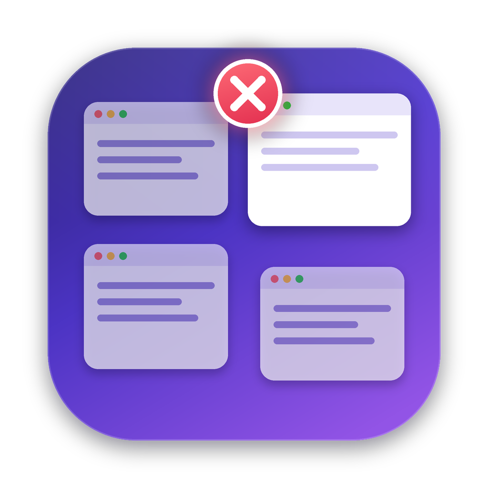
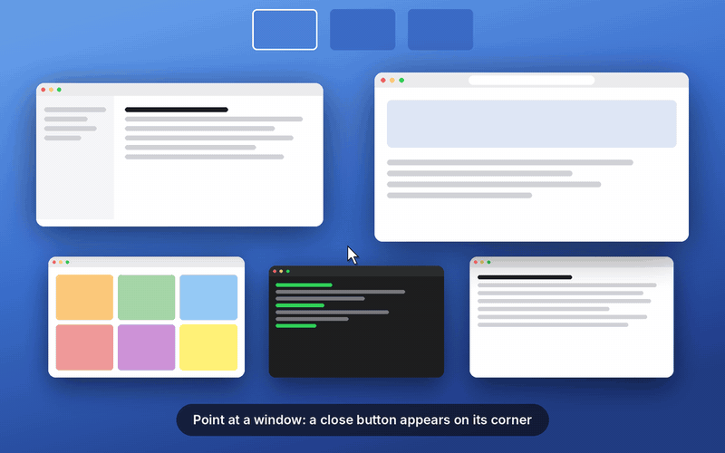

  

<h1 align="center">Mission Deck</h1>

  
  
  
  

  

## About
MissionDeck is AI Generated, but reviewed by a developer. 

## What it does

Point at any window in Mission Control and a close button appears on its corner. Click it to close the window.

You can also point at a window and press:

- **⌘W** to close it
- **⌘M** to minimize it
- **⌘H** to hide its app
- **⌘Q** to quit its app

The arrow keys move between windows, and Return opens the selected one. Every feature can be turned off from the menu bar icon.

## Install

1. Download the `.dmg` file from [Releases](../../releases/latest).
2. Open it and drag **MissionDeck** to **Applications**.
3. Open MissionDeck. The first time, macOS blocks it because the app isn't registered with Apple. Go to **System Settings → Privacy & Security**, click **Open Anyway**, and confirm.
4. When MissionDeck asks, turn it on under **Privacy & Security → Accessibility**.
5. Open Mission Control and point at a window.

## Uninstall

Click the MissionDeck icon in the menu bar and choose **Uninstall MissionDeck**. It removes the app, its settings and its permission.

## Privacy

MissionDeck has no internet connection and collects no data. It needs Accessibility access to see and close windows, and only reacts to the keyboard and mouse while Mission Control is open.

## License

[MIT](LICENSE): free to download, use, change and share. Keep the license notice with any copy.

Mac, macOS and Mission Control are trademarks of Apple Inc. MissionDeck is not affiliated with Apple.
